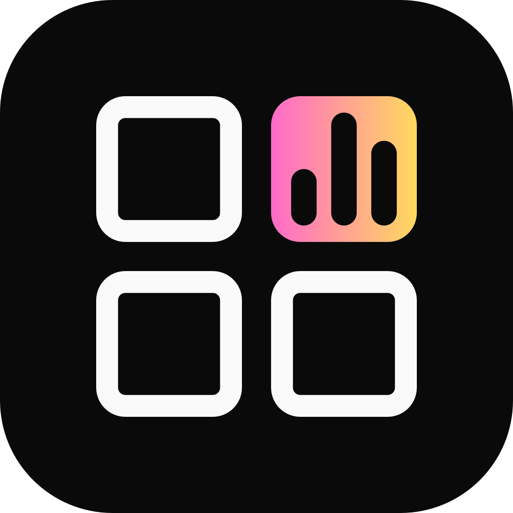
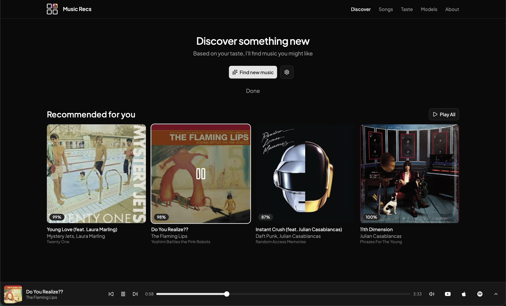
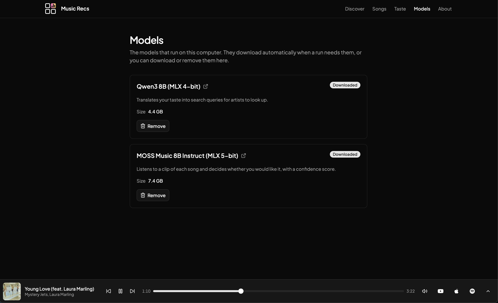

  

# Music Recs

Music Recs is a desktop app that recommends songs based on your musical taste. It finds music online and analyzes it with local audio models, so your taste and listening history stay on your device.

## Requirements

- **Operating system:** macOS 14 or later
- **Processor:** Apple Silicon (M1 or newer). Intel Macs and Windows PCs are not supported (yet).
- **Memory:** 16 GB or more of unified memory. Peak usage is around 9 GB while a song clip is analyzed.
- **Disk space:** at least 12 GB free for the two models, which are stored in the Hugging Face cache.
- **Internet:** needed to download the models, search and fetch audio from YouTube Music, and look up artwork from MusicBrainz and the Cover Art Archive.

## Installation

1. Download the latest version from the [Releases page](https://github.com/willbraun/music-recs/releases/latest). It will be under Assets in the format **Music-Recs-X.Y.Z-macos-aarch64.dmg**.
2. Open the `.dmg` file and drag **Music Recs** into your Applications folder.
3. Open Music Recs. The first launch can take a while, because the app sets up its database and loads its audio libraries.

## Models

Music Recs uses two models, which are downloaded from Hugging Face and run on your computer. They are not bundled with the app, and recommendations won't work until both are downloaded.

You can start the download from the **Models** page, or from the taste modal the first time you open the app. You can keep entering your taste while they download. Once downloaded, the models stay on disk until you remove them from the Models page.

- [Qwen3 8B (MLX 4-bit)](https://huggingface.co/Qwen/Qwen3-8B-MLX-4bit) translates your musical taste into search queries.
- [MOSS Music 8B Instruct (MLX 5-bit)](https://huggingface.co/FractalSurfer/MOSS-Music-8B-Instruct-mlx-5bit) listens to each song clip and decides whether you would like it.

## How to use Music Recs

1. **Download the models** from the **Models** page or from the taste modal that appears on first launch. This can take a while.
2. **Enter your taste.** On first launch, the taste modal asks what music you like. Add genres and artists you like and don't like, and any other notes. You can change it later on the **Taste** page. You may enter your taste while the models download in the background.
3. **Find new music.** On the **Discover** page, choose how many songs to find (1 to 50) and set the exploration level, then press **Find new music**.
   - **Familiar** stays close to your taste. **Adventurous** looks for genres and artists adjacent to your taste that you may still like.
   - The app generates search queries from your taste, searches YouTube Music, takes a short clip from each candidate song, and uses the audio model to decide whether you would like it.
4. **Listen.** Recommended songs appear on the page. Play them one at a time, or use **Play All**.
5. **Open songs in your music service.** Each song has links to open it in YouTube, Apple Music, or Spotify. The Apple Music and Spotify links open a web search for the song, so you can find and save it in those services.
6. **Come back later.** The **Songs** page lists the songs you've been recommended before. Run **Find new music** again whenever you want a fresh batch.

Your taste and the song recommendations are stored locally on your computer. Short audio clips are downloaded temporarily for analysis and then deleted. Songs are streamed through YouTube, so no music is saved on your computer.

## Building from source

See [BUILDING.md](BUILDING.md) for setup, building the desktop app, signing, and releasing.

## Contributing

Issues are welcome. For larger changes, please open an issue first to discuss it. This is a personal project, so I may not merge every pull request.

## License

Music Recs is released under the [MIT License](LICENSE). The two models are licensed separately under Apache 2.0 and are downloaded from Hugging Face, not bundled with the app.

The app searches YouTube Music and looks up artwork from MusicBrainz and the Cover Art Archive. Use of those services is subject to their own terms.
